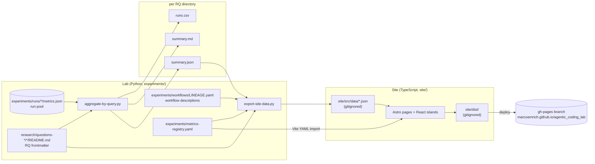
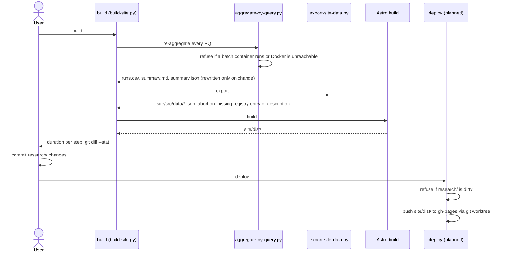
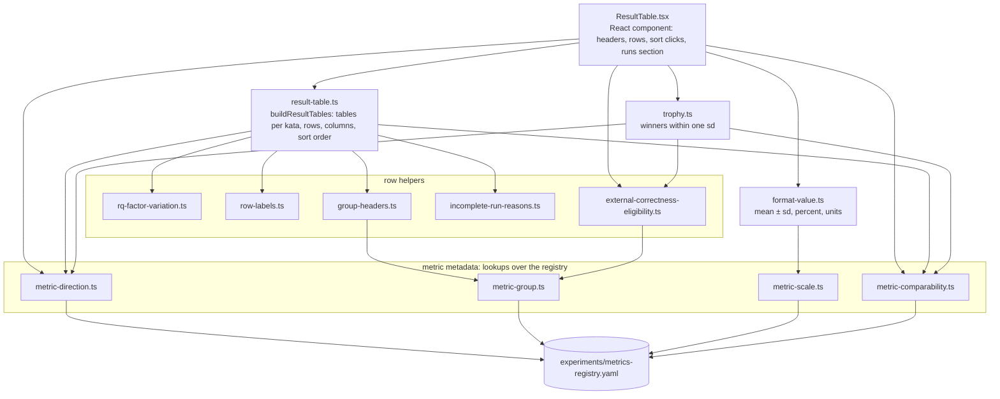
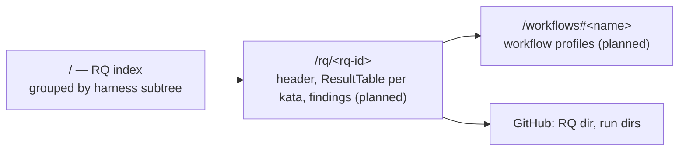

# Results site — architecture

A static site that publishes the lab's research questions (RQs) as consistently formatted
result tables. It is built locally from the run pool and pushed to GitHub Pages.
Design decisions: [open-questions.md](open-questions.md).
Story status and pending Example Mappings: [README.md](README.md#progress).

Status markers: **built** exists and is tested; **planned** is decided, not yet built.

## Overview



Two halves meet at two contracts: the JSON files in `site/src/data/` and the metric
registry, which both sides read directly. Python owns every statistic (one implementation,
shared with `summary.md`); TypeScript owns presentation — formatting, trophies, sort order
and gap states.

## Build and deploy

Nothing runs in CI. Both steps run on the host, on the user's explicit call.



The published site therefore always matches a commit: the numbers on a page are the
numbers in that commit's `runs.csv` / `summary.md`.

## Artifacts

| Artifact | Location | Written by | Tracked | Status |
|---|---|---|---|---|
| Run metrics | `experiments/runs/<run-id>/metrics.json` | `analyze-run.sh` | yes | built |
| RQ definition | `research/questions-*/<chapter>-<slug>/README.md` | by hand | yes | built |
| Per-run rows | `<rq-dir>/runs.csv` (incl. `started_at`, `harness`, `prompt_style`), sorted by `run_id`; unfinished runs (no `exit_reason`) left out | `aggregate-by-query.py` | yes | built |
| Human summary | `<rq-dir>/summary.md` | `aggregate-by-query.py` | yes | built |
| Machine summary | `<rq-dir>/summary.json`: per cell × outcome `mean`, `sd`, `n`, null count (only `ok` runs); per cell run counters and run list (sorted by `run_id`); every declared cell, unrun ones included | `aggregate-by-query.py` | yes | built |
| Findings | `<rq-dir>/findings.md` (shown collapsed, "AI-generated") | `/run-rq`, `/reanalyze` | yes | built |
| Workflow descriptions | `experiments/workflows/LINEAGE.yaml` → `description:` | by hand | yes | built |
| Metric registry | `experiments/metrics-registry.yaml`: group, direction, scale, comparability flags, a one-sentence description for the header tooltip; read by the export and imported by the site. Covers every outcome a main RQ declares; only consolidated metrics are rated | by hand | yes | built |
| Site data | `site/src/data/rq/<rq-id>.json`, `workflows.json` | `export-site-data.py` | no | built |
| Site build | `site/dist/` | Astro | no | built |
| Prototype | `site/prototype/` (approved look, self-contained HTML) | `site/prototype/extract.py` | yes | built |

## Directory layout

```text
site/
├── .claude/, .pi/          EXACT Coding skills (Claude Code, pi)
├── docs/architecture.md    this file
├── prototype/              approved prototype: extract.py, template.html, built HTML
├── src/                    UI logic and components, each with its *.spec.ts(x)
│   └── data/               export output (gitignored)
├── package.json            pnpm 10.30.2, vitest, typescript, react
├── vitest.config.ts        projects: unit (node, *.spec.ts), dom (happy-dom, *.spec.tsx)
└── vitest.setup.ts         Testing Library cleanup
```

## UI

The tests in `site/src/*.spec.ts(x)` are the specification (148 tests; one done story each
under `docs/stories/done/`).



`ResultTable` takes one `ResultTableInput` (`katas`, `outcomes`, `cells` with `runs` and
aggregated `values`, `min_replicates`, `workflowStyles`). Pure functions do the work;
the component holds only the sort state.

### Pages

The index and the RQ pages are built; findings and the workflow page are planned.



`pages/index.astro` renders `RqIndex` (markup) over `rq-index.ts` (groups by subtree, order
by chapter label); `pages/rq/[id].astro` builds a page only for an RQ that `hasPage()` in
`rq-pages.ts` admits — one with runs. `layouts/Page.astro` puts `TopBar` (site name, nav,
data stamp) on every page. The run facts — ok runs, coverage, span — are one implementation
in `rq-runs-summary.ts`, shared by `RqHeader`, the index and the stamp; page URLs live in
`rq-link.ts`.

Astro renders each page to static HTML; only interactive parts (`ResultTable` sorting,
collapsible sections) hydrate as React islands.

## Decisions behind the split

- **The metric registry is one YAML file read by both sides.** The export uses it to fail on
  an undeclared outcome; the site imports it at build time through a Vite YAML plugin, so the
  site tests run without an export and check against the real data.
- **Presentation rules stay in TypeScript.** Trophies, sort order and gap states decide how
  numbers are shown, not what they are. They live next to the components under test; the
  export delivers only statistics and run facts.
